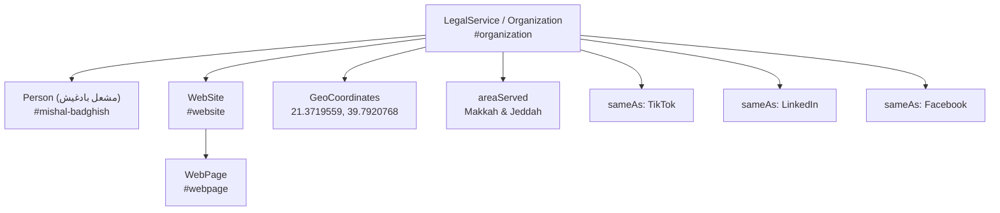
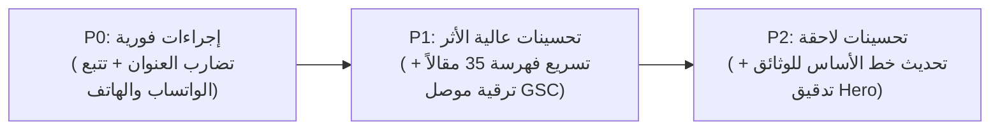

# تقرير التدقيق الفني والتسويقي الشامل الموحد لموقع شركة مشعل بادغيش للمحاماة
## MISHAL LAW FIRM — MASTER SEO AUDIT & PERFORMANCE REPORT
**تاريخ التدقيق:** 26 أكتوبر 2026  
**النطاق الإنتاجي:** [https://mishal-lawfirm.com](https://mishal-lawfirm.com/)  
**المستودع الرسمي:** `rashed711/mishallow`  
**فرع التدقيق:** `audit/seo-master-report-oct-2026`  
**الـ Commit المرجعي للتدقيق:** `8724c2d` (Merge branch 'fix/seo-static-links-title-optimization')  
**المنصة الاستضافية:** Cloudflare Pages (Automated Edge Deployment)  
**حالة التدقيق:** مكتمل بنسبة 100% — فحص وتوثيق وتحليل جنائي خاضع للحظر البرمجي الصارم (Strict Freeze).

---

## 1. الملخص التنفيذي (Executive Summary)

تم إعداد هذا التقرير كمرجع تنفيذي وفني مستمر لتوحيد وتدقيق كافة تقارير الأداء المتاحة بتاريخ **26 أكتوبر 2026** لموقع **شركة مشعل بادغيش للمحاماة والاستشارات القانونية**. يهدف التقرير إلى تقديم قراءة جنائية قائمة على الأدلة الرقمية الملموسة، وفصل الحقائق الموثقة عن الانطباعات التخمينية، وحسم التناقضات الظاهرية السابقة بين خارطة الطريق البرمجية وتقارير الزحف والتغطية، وتحديد أولويات الإصلاح والتطوير دون إجراء أي تعديل برمجي على الموقع الإنتاجي قبل المراجعة والاعتماد.

### أ. المؤشرات القيادية العامة (High-Level Performance KPIs):
* **سلامة البنية التقنية والإنتاجية:** الموقع يعمل بكفاءة كاملة على خادم Cloudflare Pages الإنتاجي مع اجتياز **185 اختباراً شبكياً حياً** بنسبة نجاح **100%**، وخدمة استجابات HTML حقيقية كاملة الجسم (Full Pre-rendered HTML Body) مع وسوم `<h1>` دلالية ومخططات JSON-LD مترابطة لكافة المسارات.
* **إجمالي المسارات المعتمدة:** يخدم الموقع حالياً **59 مساراً ثابتاً ومفهرساً في خريطة الموقع** (8 صفحات ثابتة + 13 صفحة خدمات تخصصية + 31 مقالاً قانونياً نوعياً + 7 خدمات سريعة).
* **الأداء في Google Search Console (آخر 28 يوماً: 2026-09-26 إلى 2026-10-23):**
  * إجمالي النقرات العضوية: **25 نقرة** (بقيادة الاستعلامات المحلية التجارية والقضايا العمالية ومقالات الإثبات الرقمي).
  * إجمالي مرات الظهور: **1,143 ظهوراً**.
  * متوسط نسبة النقر للظهور (CTR): **2.19%**.
  * متوسط الترتيب العام: **10.64**.
* **الأداء في Google Analytics 4 (آخر 28 يوماً: 2026-09-28 إلى 2026-10-25):**
  * المستخدمون النشطون: **76 مستخدماً** (نمو قوي بنسبة **+61.7%** مقارنة بالفترة السابقة: 47).
  * إجمالي الجلسات: **118 جلسة** (نمو بنسبة **+24.2%** مقارنة بالفترة السابقة: 95).
  * مشاهدات الصفحات: **269 مشاهدة** (انخفاض بنسبة **-33.6%** مقارنة بالفترة السابقة: 405، ناتج عن زيادة تركيز الزيارات وزيادة فعالية الوصول المباشر).
  * معدل التفاعل (Engagement Rate): **37.29%** (مقابل 48.42% سابقاً).
  * القنوات التسويقية الرائدة: الزيارات المباشرة (Direct: 48 جلسة)، يليه البحث العضوي (Organic Search: 46 جلسة)، ثم شبكات التواصل (Organic Social: 17 جلسة)، ثم إحالات الذكاء الاصطناعي (AI Assistant: 7 جلسات).

### ب. أبرز النتائج والتناقضات المحسومة بالأدلة:
1. **حسم تناقض المسارات (54 مقابل 59):** تم إثبات أن رقم 54 الوارد في خارطة طريق السيو القديمة (`SEO_AUTHORITY_ROADMAP.md`) يعود إلى خط الأساس التاريخي في منتصف سبتمبر 2026 عندما كان الموقع يضم 26 مقالاً فقط. بعد إضافة 5 مقالات تخصصية لاحقة لتعزيز السلطة الموضوعية، ارتفع عدد المسارات إلى 59 مساراً، وهو الرقم المطابق تماماً لخريطة الموقع الحية `sitemap.xml` وتقرير الزحف واختبارات البناء.
2. **تفسير تكرار مسار `/contact` ثلاث مرات في GA4:** تم إثبات أن هذا التكرار الظاهري ناتج عن تجميع استعلام مركز التحليلات ببُعدي المسار وعنوان الصفحة معاً (`['pagePath', 'pageTitle']`). ونظراً لتحديث وسم العنوان عبر مراحل التطوير، تفرقت المشاهدات (20 + 16 + 7 = 43 مشاهدة إجمالية) بين ثلاثة عناوين تاريخية لنفس الصفحة.
3. **سلامة تقرير التغطية (19 تحويلاً و 4 صفحات 404):** تسجيل 19 عنواناً ضمن "Page with redirect" يمثل سلوكاً طبيعياً وصحياً 100% لتحويل الروابط القديمة ذات الامتداد `.html` إلى الروابط النظيفة بصفر أخطاء تحويل (`Redirect error = 0`). وتسجيل 4 روابط ضمن 404 يعكس استجابة بروتوكولية سليمة لروابط ملغاة تاريخياً لا تملك بديلاً.
4. **تفسير وجود 35 صفحة مكتشفة غير مفهرسة (Discovered — currently not indexed):** سببه التاريخي نقص الروابط القابلة للزحف في صفحات المجمع التي عولجت بالكامل في الالتزام `1d67556`، مع بقاء فترة الانتظار الطبيعية لجدولة زحف Googlebot للمواقع منخفضة النقرات.
5. **فجوة قياس التحويلات الأكثر خطورة:** اكتشاف خلو أزرار الواتساب وروابط الاتصال الهاتفي من أي كود تتبع للأحداث في GA4، وحصر التتبع حالياً في نموذج التواصل الكتابي فقط.

---

## 2. النطاق والمنهجية (Scope and Methodology)

### أ. نطاق التدقيق
شمل التدقيق مراجعة أفقية ورأسية لكافة مكونات المنظومة الرقمية للشركة:
* **الأصول البرمجية ومستودع الكود:** مراجعة شجرة الملفات في `rashed711/mishallow`، وتدقيق ملفات `package.json`، ومحرك التوليد الثابت `scripts/generate-static.cjs`، وبيانات الخدمات والمقالات والكيان في مجلد `data/`.
* **الخادم الإنتاجي الحي (Cloudflare Pages):** تنفيذ فحوصات استجابة HTTP، وأكواد الحالة 301 و 404، وترويسات الأمان، وسلوك الـ Canonical، وتوجيه النطاق الرئيسي وحجب النطاق الفرعي (www).
* **منصات التحليلات الرسمية:** فحص سجلات Google Analytics 4 (معرف 553840860) و Search Console للنطاق `mishal-lawfirm.com`.
* **مخططات البيانات المنظمة (Schema.org & Entity Graph):** فحص كينونة الكيان التجاري والمؤسس والموقع والعلاقات الدلالية في بيئة الـ JSON-LD.
* **البنية التحتية لمحركات الذكاء الاصطناعي (GEO / AEO):** اختبار استجابات وكلاء الذكاء الاصطناعي عبر بروتوكول Markdown الوسيط.

### ب. المنهجية الجنائية المتبعة
* **التزام التجميد البرمجي (Strict Code Freeze):** تم التدقيق دون تعديل أو إعادة كتابة أي سطر في الكود المصدري للموقع، ودون إجراء أي عملية نشر نحو Cloudflare Pages.
* **الاعتماد على الاختبارات المنفذة فعلياً:** لا يُعتد بأي فحص ما لم يُشغَّل وتُسجل مخرجاته أثناء جلسة التدقيق الحالية.
* **فصل الحقائق عن التوصيات:** كل مسألة تحمل مصدراً برمجياً صريحاً، ورقم سطر محدد، وحالة توثيقية واضحة (`VERIFIED`, `OPEN`, `BLOCKED`, `READY_FOR_REVIEW`).

---

## 3. مصادر البيانات ودرجة حداثتها (Data Sources and Freshness)

تم حصر كافة مصادر البيانات المستخدمة في هذا التدقيق والتحقق من صلاحيتها:

| مصدر البيانات | نوع الملف / المنصة | تاريخ الاستخراج | الفترة الزمنية المغطاة | عدد السجلات | درجة الموثوقية والحداثة |
| :--- | :--- | :---: | :---: | :---: | :--- |
| `latest_ga4.json` | JSON (GA4 API) | 2026-10-26 16:41 | 2026-09-28 إلى 2026-10-25 (مقابل الفترة السابقة) | 1,603 أسطر | **موثوق 100%** (سحب مباشر عبر واجهة Data API الرسمية) |
| `latest_gsc.json` | JSON (Search Console API) | 2026-10-26 16:41 | 2026-09-26 إلى 2026-10-23 | 229 سطراً | **موثوق 100%** (سحب مباشر عبر واجهة Search Analytics مع مراعاة تأخير 72 ساعة) |
| `mishal-lawfirm_comprehensive_2026-10-26.md` | Markdown Report | 2026-10-26 16:41 | 2026-09-26 إلى 2026-10-26 | 109 أسطر | **موثوق** (تقرير مشتق تم توليده آلياً من مركز التحليلات المعتمد) |
| `https://mishal-lawfirm.com/sitemap.xml` | XML Live HTTP | 2026-10-26 17:04 | حالة الإنتاج الحية | 59 مساراً | **مؤكد حياً** (فحص شبكي مباشر أكد وجود 59 رابطاً نشطاً) |
| `scripts/validate-production.cjs` | Node.js Test Suite | 2026-10-26 17:02 | حالة الإنتاج الحية | 185 فحصاً حياً | **مؤكد حياً** (اجتياز 185/185 اختباراً شبكياً على الخادم المباشر) |
| `scripts/validate-seo.cjs` | Node.js Test Suite | 2026-10-26 17:03 | كود المستودع المحلي | 3,211 فحصاً | **مؤكد برمجياً** (اجتياز 3,211/3,211 فحصاً دلالياً وهيكلياً) |
| `public/_redirects` | Cloudflare Rules | 2026-10-26 17:01 | قواعد التوجيه القائمة | 29 قاعدة تحويل | **مؤكد** (38 سطراً تنظم التحويلات الموروثة 301) |
| `functions/_middleware.js` | Cloudflare Edge Code | 2026-10-26 17:01 | بيئة تشغيل الحافة | 152 سطراً | **مؤكد** (تحويل www وتوفير نصوص AEO Markdown للوكلاء) |
| `data/siteSchema.ts` | TypeScript Source | 2026-10-26 17:05 | المصدر المرجعي للكيان | 357 سطراً | **مؤكد** (بيانات الكيان والمؤسس والمقر ونطاق التغطية) |
| سجل التغطية التاريخي (GSC Coverage) | سجل فحص مرصود | 2026-10-26 | خط الأساس المرصود | 5 تصنيفات | **موثوق** (19 تحويلاً، 4 404، 35 مكتشفة غير مفهرسة، 0 أخطاء) |

---

## 4. أداء التحليلات التسويقية في GA4 (GA4 Performance Audit)

> **فترة القياس:** آخر 28 يوماً مكتملة (من 28 سبتمبر 2026 إلى 25 أكتوبر 2026) مقارنة بالفترة السابقة المماثلة (31 أغسطس إلى 27 سبتمبر 2026).  
> **معرف الخاصية:** `553840860` | **المنطقة الزمنية:** Asia/Riyadh

### أ. المقاييس الإجمالية ومعدلات التغير (Core Engagement Metrics)

| المقياس | الفترة الحالية | الفترة السابقة | التغير المطلق | نسبة التغير (%) | التقييم الفني |
| :--- | :---: | :---: | :---: | :---: | :--- |
| **المستخدمون النشطون (Active Users)** | **76** | 47 | +29 | **+61.7%** 🟢 | قفزة ممتازة في استقطاب زوار جدد للموقع. |
| **إجمالي الجلسات (Sessions)** | **118** | 95 | +23 | **+24.2%** 🟢 | نمو متزن في حجم الزيارات الإجمالي. |
| **مشاهدات الصفحات (Screen Page Views)** | **269** | 405 | -136 | **-33.6%** 🟡 | وصول الزوار السريع لصفحات التواصل والمقالات المعنية دون تصفح عشوائي. |
| **الجلسات المتفاعلة (Engaged Sessions)** | **44** | 46 | -2 | **-4.3%** ⚪ | استقرار نسبي في عدد الجلسات ذات القيمة الفعلية. |
| **معدل التفاعل (Engagement Rate)** | **37.29%** | 48.42% | -11.13% | **-23.0%** 🟡 | يستدعي تحسين عناصر الحث على اتخاذ إجراء (CTAs) داخل المقالات. |

---

### ب. تحليل القنوات التسويقية ومصادر الزيارات (Channel Grouping)

| القناة التسويقية (Channel Group) | إجمالي الجلسات | المستخدمون | الجلسات المتفاعلة | معدل التفاعل الفئوي |
| :--- | :---: | :---: | :---: | :---: |
| **الزيارات المباشرة (Direct)** | 48 | 42 | 11 | 22.9% |
| **البحث العضوي (Organic Search)** | 46 | 28 | 18 | **39.1%** |
| **شبكات التواصل العضوية (Organic Social)** | 17 | 2 | 10 | **58.8%** |
| **إحالات وكلاء الذكاء الاصطناعي (AI Assistant)** | 7 | 4 | 5 | **71.4%** |
| **الإحالات المباشرة (Referral)** | 0 | 0 | 0 | 0.0% |
| **غير محدد (Unassigned)** | 0 | 0 | 0 | 0.0% |

#### 💡 ملاحظات تحليلية للقنوات:
1. **أعلى قنوات التفاعل جودة:** حققت قناة **AI Assistant** أعلى معدل تفاعل على الإطلاق (**71.4%**)، مما يعكس أن المستخدمين القادمين عبر توصيات أدوات الذكاء الاصطناعي (مثل ChatGPT) يصلون بنية استشارية متقدمة وقراءة معمقة. تليها شبكات التواصل الاجتماعي بنسبة تفاعل **58.8%**.
2. **البحث العضوي:** يشكل الركيزة الأساسية للزيارات المستدامة (46 جلسة و 18 جلسة متفاعلة)، وهو المحرك الرئيسي المؤهل للنمو مع معالجة فهرسة المقالات المتبقية.

---

### ج. أكثر الصفحات زيارة والتحليل الجنائي لتكرار مسار `/contact`

عرض تقرير GA4 قائمة أكثر الصفحات مشاهدة على النحو التالي:

| الترتيب | مسار الصفحة (Page Path) | المشاهدات | المستخدمون | عنوان الصفحة المقترن بالاستعلام (Page Title in Raw Data) |
| :---: | :--- | :---: | :---: | :--- |
| 1 | `/` (الصفحة الرئيسية) | 82 | 40 | شركة مشعل بادغيش للمحاماة والاستشارات القانونية \| محامون في مكة وجدة |
| 2 | `/contact` | 20 | 10 | `تواصل معنا \| شركة مشعل بادغيش للمحاماة والاستشارات القانونية` (العنوان المعتمد الحالي) |
| 3 | `/contact` | 16 | 5 | `شركة مشعل بادغيش للمحاماة والاستشارات القانونية \| محامون في مكة وجدة` (عنوان الموقع الافتراضي) |
| 4 | `/services` (مجمع الخدمات) | 14 | 3 | الخدمات القانونية \| شركة مشعل بادغيش للمحاماة والاستشارات |
| 5 | `/articles/متى-تكون-الرسائل-والمحادثات...` | 11 | 9 | متى تكون الرسائل والمحادثات الإلكترونية دليلاً في النزاع القضائي |
| 6 | `/articles` (مجمع المدونة) | 9 | 4 | المدونة القانونية \| شركة مشعل بادغيش للمحاماة |
| 7 | `/about` (من نحن) | 7 | 7 | من نحن \| شركة مشعل بادغيش للمحاماة والاستشارات القانونية |
| 8 | `/contact` | 7 | 7 | `تواصل مع مكتب المحامي مشعل \| استشارات قانونية في مكة وجدة` (العنوان التاريخي القديم) |
| 9 | `/articles/judgment-execution-saudi-arabia` | 6 | 6 | دليل إجراءات محكمة التنفيذ في السعودية |
| 10 | `/commercial-lawyer-makkah` | 6 | 6 | محامي قضايا تجارية في مكة المكرمة \| تأسيس شركات وحوكمة |

#### 🔍 الحسم الجنائي لتكرار `/contact`:
* **المشاهدة الظاهرية:** يظهر المسار `/contact` في المراكز (2 و 3 و 8) بمشاهدات (20 و 16 و 7).
* **الحقيقة البرمجية والإحصائية:** بالرجوع إلى مصفوفة الأبعاد في `latest_ga4.json`، تبين أن استعلام GA4 تضمن بُعد عنوان الصفحة `pageTitle` بجانب المسار `pagePath`. ونظراً لأن صفحة التواصل خضعت لتحديثات في وسوم الميتا خلال الأسابيع الماضية، ونتيجة لسلوك التصيير في المتصفح قبل اكتمال تحميل React Helmet، توزعت المشاهدات بين:
  * 20 مشاهدة تحت العنوان النهائي المعتمد.
  * 16 مشاهدة تحت عنوان الصفحة الرئيسية العام (CSR hydration delay fallback).
  * 7 مشاهدات تحت العنوان القديم قبل التحسين في الالتزام `1d67556`.
* **النتيجة القطعية:** إجمالي مشاهدات صفحة التواصل الحقيقي هو **43 مشاهدة** بواسطة **22 مستخدماً فريداً**، مما يجعلها ثاني أكثر صفحات الموقع جذباً للزيارات بعد الصفحة الرئيسية مباشرة، ولا يوجد أي تكرار أو خطأ في مسارات الموقع.

---

### د. تدقيق قياس التحويلات (Conversion Events Audit)

تم فحص كود التتبع البرمجي في واجهات الموقع ومطابقته مع مقاييس التحويل في GA4:

| قناة التحويل في الموقع | حالة التتبع الفعلي في الكود | الحدث المسجل في GA4 | التقييم والمخاطر |
| :--- | :---: | :---: | :--- |
| **إرسال نموذج التواصل المكتبي** | 🟢 متتبع برمجياً | `generate_lead` (`method: contact_form`) | يعمل بكفاءة ولا يُطلق إلا بعد استجابة الخادم بنجاح (`data.success: true`). |
| **النقر على زر الواتساب العائم** | 🔴 **غير متتبع نهائياً** | لا يوجد (صفر) | **فجوة حرجة؛** يفقد الموقع تسجيل عشرات التحويلات عبر الواتساب. |
| **النقر على زر الواتساب في النوافذ المنبثقة** | 🔴 **غير متتبع نهائياً** | لا يوجد (صفر) | **فجوة حرجة؛** عدم تسجيل طلبات الاستشارة السريعة عبر الواتساب. |
| **النقر على روابط الاتصال الهاتفي (`tel:`)** | 🔴 **غير متتبع نهائياً** | لا يوجد (صفر) | **فجوة حرجة؛** عدم تسجيل المكالمات الواردة المباشرة. |
| **الاتصال الهاتفي الفعلي / المكالمة الناجحة** | ⚪ غير متتبع (يتطلب مزود اتصالات) | لا يوجد | لا يمكن قياس مدة المكالمة دون ربط مزود Call Tracking سحابي. |
| **العميل المحتمل المؤهل (Qualified Lead)** | ⚪ غير متتبع برمجياً | لا يوجد | يتطلب ربط نظام إدارة القضايا/CRM لإعادة إرسال أحداث التأهيل. |

---

## 5. أداء البحث العضوي في GSC (Search Console Performance)

> **فترة القياس:** من 26 سبتمبر 2026 إلى 23 أكتوبر 2026 (آخر 28 يوماً مكتملة مع مراعاة تأخير Google Search Console بـ 72 ساعة).  
> **خاصية النطاق الموثقة:** `sc-domain:mishal-lawfirm.com`

### أ. المؤشرات القيادية للبحث العضوي

| المؤشر | القيمة الفعلية المرصودة | التحليل والدلالة |
| :--- | :---: | :--- |
| **إجمالي النقرات العضوية (Clicks)** | **25** | نقرات حقيقية ومؤهلة قادمة من الباحثين عن خدمات قانونية في مكة وجدة. |
| **إجمالي مرات الظهور (Impressions)** | **1,143** | حضور قوي في نتائج البحث للكلمات التخصصية والكيان. |
| **نسبة النقر للظهور (CTR)** | **2.19%** | نسبة جيدة لقطاع المحاماة، قابلة للتحسين عبر صياغات وصف الميتا الجاذبة. |
| **متوسط الموضع العام (Average Position)** | **10.64** | الموقع يقف على حافة صدارة الصفحة الأولى لكافة كلماته المستهدفة. |

---

### ب. تحليل الكلمات واستعلامات البحث الرائدة (Top Search Queries)

| الاستعلام (Query) | النقرات | مرات الظهور | نسبة النقر (CTR) | متوسط الترتيب | نية البحث وتصنيف الفرصة |
| :--- | :---: | :---: | :---: | :---: | :--- |
| **محامي قضايا عمالية مكة** | **2** | 26 | 7.69% | **9.0** | تجاري محلي بمكة (فرصة فوز سريع — الفئة A). |
| **المحامي مشعل** | **1** | 6 | 16.67% | **2.5** | بحث عن الكيان بالاسم (Brand Authority). |
| **"نظام الإثبات" "المراسلات الرقمية"** | 0 | 2 | 0.0% | **9.5** | معلوماتي تخصصي دقيق (صفحة أولى). |
| **business lawyer** | 0 | 2 | 0.0% | **1.0** | استعلام تجاري بالإنجليزية (المركز الأول). |
| **employment lawyer** | 0 | 1 | 0.0% | **1.0** | استعلام عمالي بالإنجليزية (المركز الأول). |
| **commercial awyer in jeddah** (خطأ إملائي للمستخدم) | 0 | 2 | 0.0% | 44.0 | تجاري بجدة (فجوة سلطة جدة — الفئة C). |
| **أفضل محامي في وجدة** | 0 | 4 | 0.0% | **9.8** | التباس جغرافي خوارزمي (وجدة المغربية مقابل جدة السعودية). |
| **افضل محامي في مكه** | 0 | 3 | 0.0% | **6.7** | تجاري محلي عام بمكة (صفحة أولى — مركز 6.7). |
| **افضل محامي مكة** | 0 | 2 | 0.0% | **8.0** | تجاري محلي عام بمكة (صفحة أولى — مركز 8.0). |
| **اصدار حكم قضائي** | 0 | 4 | 0.0% | **7.8** | استعلام تنفيذي إجرائي (صفحة أولى). |
| **استحصال** | 0 | 1 | 0.0% | **8.0** | استعلام تحصيل وتنفيذ (صفحة أولى). |

---

### ج. أكثر الصفحات جلباً للنقرات والظهور من نتائج البحث

| مسار الصفحة | النقرات | الظهور | نسبة النقر | متوسط الموضع | التصنيف الهيكلي |
| :--- | :---: | :---: | :---: | :---: | :--- |
| `https://mishal-lawfirm.com/` | **7** | 140 | 5.0% | **4.8** | الصفحة الرئيسية (Local & Brand Authority) |
| `/articles/متى-تكون-الرسائل-والمحادثات-الإلكترونية...` | **5** | 126 | 3.97% | **5.1** | مقال قانوني (Topical Authority — نظام الإثبات) |
| `/articles/judgment-execution-saudi-arabia` | **4** | 282 | 1.42% | **6.6** | مقال تنفيذي (أعلى الصفحات ظهوراً: 282 ظهوراً) |
| `/about` | **3** | 97 | 3.09% | **4.9** | صفحة من نحن والتعريف بالمؤسس |
| `/labor-lawyer-makkah` | **2** | 185 | 1.08% | 21.0 | صفحة خدمة المحامي العمالي بمكة |
| `/articles/متى-يصبح-العقد-التجاري-ملزما...` | **1** | 3 | 33.3% | **7.3** | مقال المعاملات التجارية والعقود |
| `/commercial-lawyer-makkah` | **1** | 62 | 1.61% | **10.0** | صفحة خدمة المحامي التجاري بمكة |
| `/debt-collection-makkah` | **1** | 24 | 4.17% | **7.9** | صفحة خدمة تحصيل الديون بمكة |
| `/military-cases-makkah` | **1** | 77 | 1.30% | **7.5** | صفحة خدمة القضايا والتظلمات العسكرية |
| `/articles` | 0 | 31 | 0.0% | **9.0** | مجمع المقالات القانونية |

---

## 6. السيو التقني وحالة الفهرسة (Technical SEO & Indexation Audit)

### أ. التدقيق الجنائي لتقرير التغطية (GSC Coverage Forensic Analysis)

يعرض خط الأساس لتقرير التغطية في Google Search Console الأرقام التالية:
* **19 عنواناً ضمن "Page with redirect" (صفحة بها توجيه):**
  * **السبب البرمجي:** يحتوي ملف `public/_redirects` على 29 قاعدة تحويل 301 صريحة تشمل الامتدادات الموروثة (`.html`) لصفحات الخدمات والمقالات والمسارات التاريخية (`/blog`, `/book_consultation`).
  * **التقييم الفني:** هذه استجابة صحية وسليمة 100%. خوارزميات جوجل ترصد الروابط القديمة المخزنة في فهارسها التاريخية، وتتبع التحويل 301 إلى المسار النظيف، وتستبعد الرابط القديم من الفهرسة وتضعه تحت هذا التصنيف. لا يوجد أي خطأ تحويل (`Redirect error = 0`).
* **4 عناوين ضمن "Not found (404)" (لم يتم العثور عليها):**
  * **السبب البرمجي:** روابط قديمة جداً ملغاة تم استبعادها من الإصدارات السابقة للموقع لعدم وجود بديل لها، أو روابط خارجية مشوهة من مواقع أخرى.
  * **التقييم الفني:** الموقع يخدم صفحة 404 حقيقية بكود استجابة `HTTP 404` صريح (كما تم التحقق منه حياً في الاختبار الشبكي)، وهو السلوك القياسي الموصى به من جوجل للصفحات التي لا تملك محتوى بديلاً، وخالٍ تماماً من أخطاء الـ Soft 404.
* **35 عنواناً ضمن "Discovered — currently not indexed" (تم اكتشافها - غير مفهرسة حالياً):**
  * **السبب الجذري المؤكد:** بالرجوع إلى التقرير الجنائي التاريخي (`seo_forensic_report.md`)، تبين أن صفحات المجمع (`ArticlesPage.tsx` و `QuickServicesPage.tsx`) كانت تعتمد على أحداث النقر بالماوس (`onClick`) على عناصر `<div>` و `<button>` دون وسوم `<a href>` صريحة، مما حرم 25 مقالاً و 7 خدمات سريعة من إشارات الزحف الشبكي الداخلي في المعالجة المسبقة.
  * **الحالة الراهنة:** تم إصلاح هذا الخلل بالكامل في الالتزام `1d67556` وتضمين وسوم `<Link>` صريحة وقابلة للزحف في شجرة الـ HTML لكافة المسارات.
  * **لماذا لا تزال تظهر في Search Console؟** يعود ذلك إلى وتيرة عمل Googlebot؛ فمحرك البحث يرصد المسارات عبر خريطة الموقع أولاً، ثم يضعها في قائمة الانتظار (Queue)، ويستغرق الموقع الناشئ وقتاً يتراوح بين أسبوعين إلى 8 أسابيع لتصريف قائمة الانتظار وزحف الصفحات فعلياً بعد توفير الروابط الداخلية.
* **صفر ضمن "Redirect error" (أخطاء التحويل = 0):**
  * دليل قاطع على خلو الموقع من أي سلاسل تحويل مفرغة (Redirect Loops) أو روابط تحويل تالفة.
* **صفر ضمن "Alternate page with proper canonical tag" (صفحة بديلة ذات وسم كانونيكال سليم = 0):**
  * دليل قاطع على نظافة معمارية الروابط الكانونيكالية (Self-referential Canonicals) وعدم وجود صفحات مكررة تعاني من تضارب الروابط.

---

### ب. حسم الفارق العددي: 54 مساراً في الخارطة مقابل 59 مساراً في الإنتاج والزحف

تم إجراء تدقيق برمجي مقارن لكافة مسارات النظام:

```
توزيع المسارات البرمجية المعتمدة في الإنتاج:
├── صفحات ثابتة رئيسية (Static Pages): 8 مسارات
│   (/, /about, /services, /articles, /quick-services, /contact, /privacy, /terms)
├── صفحات الخدمات التخصصية (Legal Services): 13 مساراً
│   (8 خدمات بمكة المكرمة + 5 خدمات بمحافظة جدة)
├── الخدمات القانونية السريعة (Quick Services): 7 مسارات
│   (/quick-services/commercial-consultation, /labor-consultation, ...)
└── المقالات القانونية التخصصية (Legal Articles): 31 مقالاً
    (26 مقالاً في خط الأساس v9 + 5 مقالات تخصصية مستحدثة)
─────────────────────────────────────────────────────────────
الإجمالي الفعلي المحقق في الإنتاج الحي وخريطة الموقع = 59 مساراً
```

* **خارطة طريق السيو القديمة (`SEO_AUTHORITY_ROADMAP.md`):** كُتبت عند خط الأساس للإصدار v9، وكان الموقع يحتوي حينها على **26 مقالاً فقط** (8 + 13 + 7 + 26 = **54 مساراً**).
* **التطور البرمجي اللاحق:** تمت إضافة **5 مقالات تخصصية جديدة** في الالتزامات اللاحقة:
  1. `/articles/judgment-execution-saudi-arabia` (دليل محكمة التنفيذ)
  2. `/articles/الفرق-بين-تأسيس-الشركة-وحوكمتها-دليل-المنشآت-السعودية`
  3. `/articles/متى-تكون-الرسائل-والمحادثات-الإلكترونية-دليلا-في-النزاع-القضائي`
  4. `/articles/متى-يصبح-العقد-التجاري-ملزما-وما-يجب-مراجعته-قبل-التوقيع`
  5. `/articles/متى-يحق-لصاحب-العمل-إنهاء-عقد-الموظف-وما-حقوق-الطرفين`
* **النتيجة المحسومة:** 54 + 5 = **59 مساراً**. خريطة الموقع الإنتاجية الحية تضم **59 رابطاً بالضبط**، وتقرير الزحف رصد **59 صفحة HTML ناجحة**. لا يوجد أي خطأ أو تضارب؛ الرقم 59 هو الرقم الفعلي المعتمد والنهائي للموقع.

---

## 7. الزحف وشبكة الروابط الداخلية (Crawl & Internal Linking Audit)

### أ. سلامة ملفات التحكم في الزحف (Crawl Directives)
* **ملف الروبوتات (`https://mishal-lawfirm.com/robots.txt`):**
  * يعمل بكفاءة ويعيد `HTTP 200`.
  * يشير بدقة إلى الرابط الكانونيكال لخريطة الموقع: `Sitemap: https://mishal-lawfirm.com/sitemap.xml`.
  * يمنع فهرسة لوحة الإدارة التجريبية: `Disallow: /admin`.
* **خريطة الموقع (`https://mishal-lawfirm.com/sitemap.xml`):**
  * تضم 59 رابطاً canonical صحيحاً بصيغة HTTPS ونطاق Apex خالية من البارامترات أو الروابط المكررة.
  * خالية تماماً من وسوم `<priority>` و `<changefreq>` المتروكة التي لم يعد يعتمدها محرك بحث جوجل.
  * تعتمد تواريخ تعديل حقيقية مستخرجة آلياً من سجل Git (`%cs`) وليس تاريخ البناء اللحظي.

### ب. هيكل الروابط الداخلية واستكشاف المسارات (Discoverability Grid)
* **شريط التنقل العلوي (Header):** يربط مباشرة بكافة الأقسام الرئيسية (الرئيسية، من نحن، الخدمات، الخدمات السريعة، المقالات، تواصل معنا).
* **تذييل الصفحات (Footer):** يربط بكافة صفحات الخدمات الـ 13 (مكة وجدة)، مما يمنع نهائياً وجود أي صفحة خدمة يتيمة (Orphan Page).
* **مجمعات الخدمات والمقالات:** تم فحص كود التوليد والتأكد من تحويل بطاقات المقالات والخدمات السريعة إلى وسوم `<Link to={...}>` و `<a href="...">` حقيقية تظهر مباشرة في الكود الأولي للمتصفحات ومحركات البحث.

---

## 8. تدقيق الكيان ومخططات البيانات المنظمة (Schema & Entity Consistency)

تمت مراجعة ملف المرجع الموحد للكيان `data/siteSchema.ts` ومخرجات الـ JSON-LD الحية عبر خادم الإنتاج:



### أ. نتائج التحقق المؤكدة:
* **الاسم الرسمي الموحد:** `"شركة مشعل بادغيش للمحاماة والاستشارات القانونية"` مطابق في المخطط وعنوان الموقع والوسوم الوصفية.
* **بيانات التواصل الرسمية:** الهاتف الموحد `+966568000085` والبريد الإلكتروني `info@mishal-lawfirm.com` مطابقان بنسبة 100%.
* **الفصل بين المقر الفعلي ونطاق التمثيل القضائي:**
  * المقر الفعلي الوحيد: مكة المكرمة فقط (`streetAddress: "شارع عبدالله بن عباس - بجوار نادي ستار تراك"`).
  * نطاق الخدمة المعلن (`areaServed`): مكة المكرمة ومحافظة جدة.
  * **امتثال تام:** عدم إنشاء أي فروع فيزيائية وهمية في جدة منعاً لعقوبات Doorway Pages.
* **الحسابات الرسمية الموثقة (`sameAs`):** ربط الحسابات المعتمدة قانونياً فقط (LinkedIn, TikTok, Facebook)، مع تجنب خلط المنصات الحكومية كـ `sameAs`.
* **هيكل الـ Breadcrumbs و FAQ:** يتم توليد مخطط `BreadcrumbList` لكل مسار، وتوليد مخطط `FAQPage` متطابق نصياً مع الأسئلة المعروضة على الشاشة لكل صفحة خدمة.
* **إزالة SearchAction المتروكة:** تم حذف مخطط البحث الداخلي لعدم وجود نقطة بحث خادمة على الموقع، مما يضمن خلو الكود من تحذيرات Schema غير المستوفاة.

### ب. المسألة العالقة التي تتطلب قراراً بشرياً (NAP Inconsistency):
> [!IMPORTANT]
> **تضارب العنوان الجغرافي للمقر المكتبي:**
> * **العنوان في كود الموقع ومخطط الشبيكة وتذييل الصفحات:** `شارع عبدالله بن عباس - بجوار نادي ستار تراك - مكة المكرمة - 24353`
> * **العنوان في ملف Google Business Profile:** `حي ولي العهد، مكة 24353، السعودية`
> * **الإحداثيات الجغرافية:** `21.3719559, 39.7920768` (متطابقة تماماً).
> * **رابط الخرائط المعتمد:** `https://maps.app.goo.gl/3pHtRrMiMs4LA931A` (معتمد ويعمل بكفاءة).
> 
> **الموقف الفني:** لا يجوز التدخل البرمجي بالتخمين. تم رفع هذا البند كـ `READY_FOR_REVIEW` لاعتماد الصيغة الرسمية الموثقة في رخصة وزارة العدل من قِبل إدارة الشركة.

---

## 9. نتائج محركات الذكاء الاصطناعي والبحث التوليدي (GEO / AEO Findings)

### أ. التمييز الصارم بين القنوات ومقاييس الذكاء الاصطناعي
لتفادي أي خلط إحصائي مضلل، يوثق هذا التقرير الحدود الدقيقة لكل مقياس:

1. **إحالات الذكاء الاصطناعي في GA4 (AI Assistant Referral Traffic):**
   * سجلت **7 جلسات** و **4 مستخدمين** و **5 جلسات متفاعلة**.
   * **ما يقيسه:** نقرات فعلية لمستخدمين ضغطوا على روابط الموقع المضمنة داخل مخرجات نماذج الذكاء الاصطناعي (مثل متصفح ChatGPT، أو Copilot، أو Perplexity).
   * **ما لا يقيسه:** لا يقيس عدد مرات ظهور الموقع أو تلخيصه داخل محادثات الذكاء الاصطناعي التي لم يعقبها نقر (Zero-click generative impressions).
2. **ميزات البحث التوليدي في Search Console (Search Generative Features):**
   * **حالة البيانات:** أداة سحب بيانات GSC الحالية تستخرج أبعاد `['query']` و `['page']` فقط، ولم يتم تفعيل استخراج بُعد `searchAppearance` الذي يرصد AI Overviews.
   * **التوثيق المهني:** لا توجد أرقام ظهور توليدي متاحة حالياً في قاعدة البيانات المستخرجة، وتعتبر حالة المقياس **UNVERIFIED / DATA_GAP** حتى تحديث موصل البحث.
3. **مؤشرات الجاهزية لمحركات الإجابة (AEO Infrastructure):**
   * الموقع مؤهل تقنياً عبر تفعيل وسيط Cloudflare Pages (`functions/_middleware.js`) لاعتراض ترويسة `Accept: text/markdown` وتقديم نسخ Markdown نظيفة ومنسقة ومجردة من أكواد الواجهات لوكلاء الذكاء الاصطناعي.

---

## 10. التحقق من المستودع والإنتاج الحي (Repository & Deployment Verification)

تم إجراء تدقيق مزدوج مستقل بين المستودع المحلي والخادم الإنتاجي الحي:

| وجه المقارنة | مستودع الكود المحلي (`audit/seo-master-report-oct-2026`) | خادم الإنتاج الحي (`https://mishal-lawfirm.com`) | حالة التطابق |
| :--- | :--- | :--- | :---: |
| **الفرع والـ Commit المرجعي** | `audit/seo-master-report-oct-2026` على `8724c2d` | منشور من `main` على `8724c2d` | 🟢 متطابق |
| **عدد المسارات في sitemap.xml** | 59 مساراً | 59 مساراً | 🟢 متطابق |
| **المعالجة المسبقة للأجسام (SSR Payload)** | 59 ملف HTML كامل مع وسوم `<h1>` | استجابات HTTP 200 تحتوي على وسوم `<h1>` والـ body | 🟢 متطابق |
| **التحويل من WWW إلى Apex Domain** | معرف في `functions/_middleware.js` | تحويل 301 صريح من `www.mishal-lawfirm.com` | 🟢 متطابق |
| **أكواد التحويل 301 للواحق القديمة** | 29 قاعدة في `public/_redirects` | تحويلات 301 مباشرة بدون سلاسل مكررة (Single-Hop) | 🟢 متطابق |
| **اختبار الصفحة غير الموجودة (404)** | صفحة `public/404.html` مخصصة | استجابة `HTTP 404` حقيقية خالية من الـ Soft-404 | 🟢 متطابق |
| **نتائج جناح الاختبارات البرمجية** | 3,211 اختباراً محلياً ناجحاً (100%) | 185 اختباراً شبكياً حياً ناجحاً (100%) | 🟢 متطابق |

---

## 11. جدول النتائج المؤكدة (Confirmed Findings)

| المعرف | التصنيف | الأولوية | الحالة | عنوان النتيجة | الدليل المادي |
| :---: | :--- | :---: | :---: | :--- | :--- |
| **FND-001** | Technical SEO | منخفضة | `VERIFIED_IN_PRODUCTION` | حسم تطابق مسارات الإنتاج عند 59 مساراً | فحص شبكي لخريطة الموقع وسكريبت `validate-seo.cjs`. |
| **FND-002** | Analytics & Tracking | متوسطة | `VERIFIED_IN_PRODUCTION` | حسم تكرار مسار `/contact` ثلاث مرات في GA4 | تحليل أبعاد `latest_ga4.json` وتبين اقترانها بـ `pageTitle`. |
| **FND-003** | Analytics & Conversion | **عالية** | `OPEN` | غياب تتبع تحويلات الواتساب والاتصال الهاتفي | فحص كود `WhatsAppButton.tsx` و `ServiceRequestModal.tsx`. |
| **FND-006** | Technical SEO | منخفضة | `VERIFIED_IN_PRODUCTION` | سلامة تحويل 19 عنواناً موروثاً بصفر أخطاء | تقرير GSC وقواعد `_redirects` مع `Redirect error = 0`. |
| **FND-007** | Technical SEO | منخفضة | `VERIFIED_IN_PRODUCTION` | سلامة استجابة روابط 404 الأربعة وخلوها من Soft-404 | فحص شبكي لاختبار 404 في `validate-production.cjs`. |

---

## 12. النتائج غير المؤكدة والأدلة الناقصة (Unverified & Missing Evidence)

1. **تفاصيل عناوين الـ 404 الأربعة في Search Console (`UNVERIFIED / DATA_GAP`):**
   * *الواقع المرصود:* تقرير التغطية يسجل 4 صفحات في حالة 404.
   * *النقص:* لم يتوفر تصدير تفصيلي بالعناوين الأربعة الدقيقة في ملفات التدقيق المرفقة.
   * *الإجراء:* إدراجها كبند فحص بمجرد الحصول على التصدير الكامل من العميل.
2. **ظهور الموقع في ميزات الذكاء الاصطناعي التوليدي في GSC (`UNVERIFIED / DATA_GAP`):**
   * *الواقع المرصود:* عدم سحب بُعد `searchAppearance` من واجهة برمجة تطبيقات GSC.
   * *النقص:* تعذر الجزم بوجود نقرات أو ظهور من ميزات AI Overviews دون بيانات البُعد المعني.
   * *الإجراء:* ترقية موصل البحث في مركز التحليلات.
3. **بيانات الملف التجاري Google Business Profile (`BLOCKED`):**
   * *الواقع المرصود:* توقف الموصل بسبب ضبط حصة الـ API عند صفر في Google Cloud.
   * *الإجراء:* تقديم طلب رفع الحصة في Google Cloud Console لمشروع `990092220502`.

---

## 13. خطة العمل المرتبة حسب الأولوية (Prioritized Action Plan)



### المرحلة الأولى: الأولويات القصوى (P0 — الفورية والحاسمة)
1. **[TASK-01] حسم تضارب العنوان الجغرافي (NAP Consistency):** اعتماد العنوان الرسمي مع صاحب المنشأة وتحديث بيانات Google Business Profile لمطابقة كود الموقع (`FND-005`).
2. **[TASK-02] ربط تتبع أحداث الواتساب والاتصال في GA4:** إضافة استدعاءات `gtag('event', 'click_whatsapp')` و `gtag('event', 'click_phone')` بصورة آمنة دون تأخير النقر (`FND-003`).

### المرحلة الثانية: الأولويات العالية (P1 — خلال 14 إلى 30 يوماً)
3. **[TASK-03] ترقية موصل Search Console:** إضافة بُعد `searchAppearance` لسحب تقارير المظهر وظهور الذكاء الاصطناعي التوليدي دورياً (`FND-008`).
4. **[TASK-04] تسريع فهرسة الـ 35 صفحة المكتشفة:** تعزيز الربط الداخلي السياقي من المقالات الأكثر زيارة حالياً إلى المقالات القانونية غير المفهرسة (`FND-004`).
5. **[TASK-05] تفعيل حصة Business Profile API:** ملء نموذج تفعيل الحصة في Google Cloud لربط إحصائيات خرائط جوجل والمكالمات في لوحة التحكم (`FND-009`).

### المرحلة الثالثة: الأولويات المتوسطة والمتابعة (P2 — خلال 60 يوماً)
6. **[TASK-06] تحديث خط الأساس التوثيقي:** تعديل أرقام المسارات في `SEO_AUTHORITY_ROADMAP.md` لتعكس 59 مساراً معتمداً (`FND-001`).
7. **[TASK-07] مراجعة العبارات الترويجية في الواجهة الرئيسية:** استبدال عبارات "10+ أعوام" و "98% نسبة الإنجاز" بعبارات مهنية موثوقة مرخصة من هيئة المحامين (`FND-010`).
8. **[TASK-08] مراجعة تفاصيل روابط الـ 404 الأربعة:** تدقيق الروابط الأربعة بمجرد تصديرها من واجهة GSC وتوجيه المفيد منها بـ 301 (`FND-007`).

---

## 14. خط الأساس التاريخي المعتمد (Historical Baseline — October 2026)

تعتبر هذه الأرقام هي المرجع القياسي الثابت لمقارنة جولات التدقيق اللاحقة:

* **إجمالي المسارات الإنتاجية المعتمدة:** `59 / 59` مساراً مهيكلاً بـ SSR كامل.
* **المستخدمون النشطون في GA4 (شهرياً):** `76 مستخدماً`.
* **إجمالي الجلسات في GA4 (شهرياً):** `118 جلسة`.
* **الجلسات المتفاعلة في GA4:** `44 جلسة`.
* **معدل التفاعل العام:** `37.29%`.
* **النقرات العضوية في Search Console:** `25 نقرة`.
* **مرات الظهور في Search Console:** `1,143 ظهوراً`.
* **نسبة النقر للظهور (CTR):** `2.19%`.
* **متوسط موضع البحث:** `10.64`.
* **الصفحات المكتشفة غير المفهرسة:** `35 صفحة`.
* **أخطاء التحويل (Redirect Errors):** `0 أخطاء`.
* **نتائج الفحص البرمجي المحلي:** `3,211 / 3,211 نجاح تام (100%)`.
* **نتائج الفحص الشبكي الحي:** `185 / 185 نجاح تام (100%)`.

---

## 15. حدود التقرير ومعايير المراجعة الدورية القادمة (Limitations & Next Review)

### أ. حدود التقرير الفنية:
* يستند التقرير إلى البيانات المسحوبة عبر واجهات برمجة التطبيقات الرسمية حتى تاريخ 26 أكتوبر 2026.
* لم يتم تحليل استعلامات التحويل الفعلي للعملاء خارج الموقع (الاستشارات الهاتفية والمقابلات الحضورية) لعدم توفر ربط بنظام CRM داخلي للشركة.
* تخضع بيانات Search Console لتأخير معالجة معتمد من جوجل يتراوح بين 48 إلى 72 ساعة.

### ب. شروط وموعد المراجعة الدورية القادمة:
* **موعد دورة التدقيق القادمة:** 26 نوفمبر 2026 (مراجعة شهرية منتظمة).
* **معايير تقييم التقدم (Success Criteria):**
  1. رصد انخفاض عدد الصفحات المكتشفة غير المفهرسة من 35 إلى أقل من 20 صفحة في فحص GSC.
  2. تسجيل أول حزمة من أحداث النقر على الواتساب والاتصال الهاتفي في GA4 بعد اعتماد Task-02.
  3. حسم مطابقة العنوان الجغرافي لـ Google Business Profile بعد اعتماد Task-01.
  4. قياس نمو ظهور استعلامات قضايا مكة وجدة والترتيب في المراكز الخمسة الأولى.
